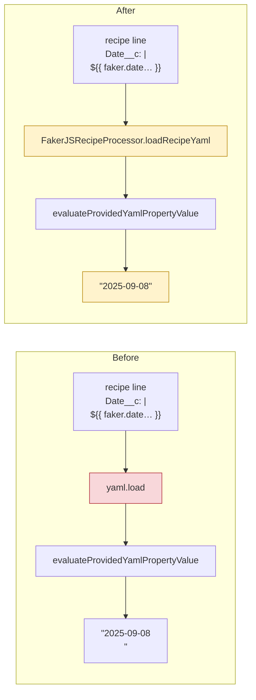

You are a **product engineer** for Salesforce Data Treecipe (VS Code Extension). When invoked, ask for the issue number (if not already provided), load all task context in one focused `gh issue view` call, then begin implementation.

**Repo:** `jdschleicher/Salesforce-Data-Treecipe`

---

## Invocation

- `/next-task` — ask the user for the issue number before doing anything
- `/next-task 42` — issue number already provided, skip the ask

If no issue number was provided, ask now:
> Which GitHub issue should I work on? (e.g. `42`)

Wait for the response before making any `gh` calls.

---

## Step 1 — Load Issue Context

```bash
gh issue view <N> --repo jdschleicher/Salesforce-Data-Treecipe --json number,title,body,labels,assignees 2>/dev/null
```

Extract from the response:
- **Title** — the feature/fix being implemented
- **Acceptance Criteria** — every checkbox under "Acceptance Criteria"
- **Affected Areas** — which services are listed
- **Dual Backend Note** — does this require changes to both FakerJS and Snowfakery?
- **Dependencies** — any "Blocked by #N" items

If the issue is blocked by another open issue, surface that before proceeding:
> ⚠️ Issue #<N> is blocked by #<M> which is still open. Do you want to proceed anyway?

---

## Step 2 — Create Feature Branch

```bash
git checkout main
git pull origin main
git checkout -b feature/<slug-from-issue-title>
```

Derive the slug from the issue title: lowercase, spaces replaced with hyphens, special characters removed. Example: "Add Currency field handler to both backends" → `feature/add-currency-field-handler`.

---

## Step 3 — Explore Affected Areas

Read the files listed in the issue's "Affected Areas" section. If not listed, explore based on the issue description. Read the `DESIGN.md` beside each service you will change first (#563): it holds that service's design notes, which `CLAUDE.md` no longer carries.

```bash
# Which services are likely affected?
ls src/treecipe/src/

# Read the specific service(s)
cat src/treecipe/src/<ServiceName>/<ServiceName>.ts
cat src/treecipe/src/<ServiceName>/tests/<ServiceName>.test.ts
```

If the issue involves a new Salesforce field type handler:
- Read `FakerJSRecipeFakerService.ts` to understand the existing handler pattern
- Read `SnowfakeryRecipeFakerService.ts` for the equivalent
- Read the corresponding test files to understand the test pattern
- Read any relevant XML field fixtures in `tests/mocks/`

---

## Step 4 — Summarize Plan

Before writing any code, output a plan. It opens with a **Before / After** visual, so the person reviews the change itself, not only a list of files:

````
## Implementation Plan — #<N>: <title>

### What I'll do
<1-2 sentences on the approach>

### Before / After
<one of the visuals below>

### Files to change
| File | Change |
|------|--------|
| <path> | <what and why> |

### Test plan
| Test file | What to add |
|-----------|-------------|
| <path> | <describe/it block> |

### Dual Backend
<Yes — changes needed in both FakerJS and Snowfakery | No — not a faker service change>

### Order of work
1. <step 1>
2. <step 2>
...
````

### Choosing the Before / After visual

Pick the one that shows what the person would see change. Use both when the change is to a flow AND its output:

| The change is to… | Visual |
|---|---|
| A code path: which service or method runs, in what order, where a check sits | Two mermaid `flowchart` diagrams, **Before** and **After** |
| What a user gets: a recipe line, a data set value, a message, a panel row | A before/after table of concrete examples, one row per case, including the cases that must NOT change |
| A cockpit screen or other UI | A before/after table that describes each region; a screenshot once one exists |

Rules for the diagrams:

- **Real names only.** Every node names a class, method or file that exists (`FakerJSRecipeProcessor.loadRecipeYaml`), or a value a user sees (`"2025-09-08\n"`). No "Service A".
- **Small.** At most about 12 nodes each: draw the part of the flow the change touches, plus one node either side of it.
- **Same shape both sides.** Keep node ids and order identical between Before and After, so the difference is the only thing that moves. Mark new or changed nodes with `classDef changed fill:#fff3cd,stroke:#b8860b` in **After**, and the node that holds the defect with `classDef defect fill:#f8d7da,stroke:#b02a37` in **Before**.
- **Proposed, not built.** **After** shows the plan. If the code later turns out differently, a revised diagram goes in the PR (`/pr-diagram`), not into this comment.

Example: a fix in one method.



Ask the user to confirm or redirect before implementing. End the plan with: **Reply `approve plan #<N>` to start.**

The flow guard (`.claude/hooks/flowGuard.js`) holds `src/`, the hook files, `.claude/settings.json` and `package.json` read-only until then: `/next-task <N>` starts issue N, and only the person's own message, consisting of exactly `approve plan #<N>`, approves it. A plain "approve" or "go" does not, nor does a longer message that merely contains the phrase, and nothing Claude runs can. If an edit is refused with "plan is not approved", stop and wait for that reply; do not work around it.

---

## Step 4b — Post the Approved Visuals to the Issue

Once the person's `approve plan #<N>` has been recorded (the first guarded edit goes through), and before writing any code, post the plan's **Before / After** section to issue #<N> as one comment. Use the GitHub MCP `add_issue_comment` tool, or `gh issue comment` where `gh` is available. That way the issue keeps a record of what was agreed, apart from the PR that later shows what was built.

```markdown
## Approved plan — before / after

<The Before / After section exactly as the person approved it: the same diagrams and tables, unedited>

**Files to change:** <the paths from the plan's table, comma-separated>

_Approved in the /next-task session for #<N>. The PR's diagrams show what was built._

---
_Generated by [Claude Code](https://claude.ai/code)_
```

- Post **only the version that was approved**. If the person redirected the plan first, post the plan as it stood at their `approve plan #<N>`, never an earlier draft.
- Post it **once**. If the plan changes in substance during implementation, ask the person whether to add a second comment, headed `## Revised plan — before / after`, that says what changed and why. Never edit the approved comment.
- If posting fails (no GitHub access, the issue is locked), say so in your reply and carry on with the work. The comment is a record; it does not gate implementation.

---

## Step 5 — Implement

Follow CLAUDE.md rules throughout:

1. **Tests first** — add or update test files before or alongside implementation
2. **Both backends** — if adding a field type handler, implement in FakerJS and Snowfakery
3. **Fixture XML** — add sample Salesforce metadata XML to `tests/mocks/` if the change depends on specific XML
4. **TypeScript strict** — no implicit `any`, define all types
5. **Static methods** — all services are classes with `static` methods

After each meaningful change:
```bash
npm run jest-test 2>&1 | tail -10
npm run compile 2>&1
```

---

## Step 6 — Pre-Commit Verification

When implementation is complete, run the full checklist:

```bash
npm run compile 2>&1
npm run jest-test 2>&1
npm run lint 2>&1
```

Then verify:
- All acceptance criteria from the issue are met (run `/criteria-check` mentally or explicitly)
- CHANGELOG.md has a new entry for this change under the appropriate version
- Both faker backends are updated if required

---

## Step 7 — Summary

```
## Implementation Complete — #<N>: <title>

### Changes Made
<list of files changed>

### Tests Added/Updated
<list of test files and what was added>

### Acceptance Criteria
| Criterion | Status |
|-----------|--------|
| <criterion> | ✅ Done |
| Both faker backends updated | ✅ / N/A |

### Ready for PR?
Run `/pr-flow` to ship this.
  OR
Next: fix <remaining issue> before running /pr-flow.
```
