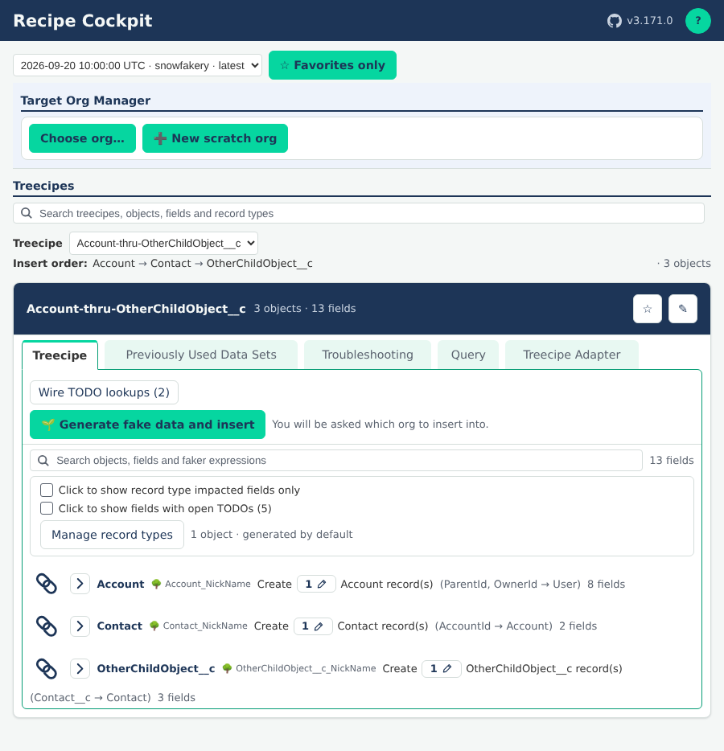

# Recipe Cockpit guide

The Recipe Cockpit shows the recipes Generate Treecipe wrote as cards you can open, trim and generate from.
Click **?** at the top right of the cockpit, beside the version and the GitHub icon, for the short version of this page.

A few words used below:

- **Run**: one Generate Treecipe output, a timestamped folder under `treecipe/GeneratedRecipes`.
- **Tree**: a group of related objects written to one recipe file, parents before children. Each card is one tree.
- **Recipe file**: the `.yml` file Run Faker reads to make fake records.

<!-- Kept in step with RECIPE_COCKPIT_HELP_SECTIONS in src/treecipe/src/RecipeCockpitService/RecipeCockpitService.ts by /cockpit-help-sync. The ## headings below must match the help's, in the same order: a test checks them. -->

## Where recipes come from

Generate Treecipe reads your object metadata and writes a run: a folder under `treecipe/GeneratedRecipes` holding the recipe files and a list of the objects it read.
The cockpit opens the newest run, or the one you pick in the run list at the top.
Under the run list, the **Target Org Management** section picks the org a card can insert into, opens it in your browser (**Open in browser**) or makes a new scratch org (**+ New scratch org**), which it creates and selects without deploying anything to it. It stays at the top of the panel while you scroll.
The **Treecipes** section below it holds the cards.

Generate Treecipe marks what still needs a hand edit with a TODO comment, such as a lookup with no parent yet or a validation rule it could not apply.
Tick **TODOs only** on a card's Treecipe tab to see just the fields and objects with one, or open its **Troubleshooting** tab, whose **TODO's** list shows them all with a link to each line.

The **Troubleshooting** tab shows one area at a time: **TODO's**, **Fields**, **Permissions**, **Validation Rules**, **Record Types** and **Global Value Sets**, each with its own search.
It opens on the one you chose last.
**Validation Rules** lists each object's validation rules from your project: whether each is active, its error message, the fields it constrains and whether Generate Treecipe applied it, or why not.
**Show formula** opens a rule's formula.

## What the cockpit changes without editing the YAML

These settings change what is generated, but the recipe file stays exactly as Generate Treecipe wrote it, so it always shows what was generated from your metadata:

- **Excluded objects** (the chain link): the object and its children are left out.
- **Unticked fields**: the field is left out.
- **Record counts**: how many records an object gets.
- **The rules box**: a field generated without the limits its validation rules set.

## What does edit the YAML

These buttons rewrite the recipe file itself, because the change belongs in the recipe:

- **Wire to…** and **Wire TODO lookups**: fill a lookup's TODO with its parent's nickname.
- **Add &lt;parent&gt; to recipe**: adds a standard parent object, such as Account, above the child that needs it.
- **+** beside an object that looks up to itself: adds a child record under it.
- **Edit** (the pencil on a field): opens the field's faker expression to change its arguments or call another faker method, or to replace it with one fixed value for every record. It is written into the recipe so Run Faker by Recipe uses it too. The lines it replaced are kept in a `.fixedValues.json` file beside the recipe, and **Clear** puts them back exactly.

Three more write other files: **Remember this selection** saves record types to `treecipe.config.json`, and on a card's **Troubleshooting** tab, **Generate permission set** (under **Permissions**) writes a permission set into your project and **Retrieve validation rules** (under **Validation Rules**) writes an org's validation rules into your project.

The **Troubleshooting** tab also deploys to a sandbox or scratch org, never production: **Deploy permission set** (**Permissions**), **Deploy fields** (**Fields**, custom fields only), **Deploy record types** (**Record Types**) and **Deploy global value sets** (**Global Value Sets**) each send just those parts of your project, after a confirmation that lists them.

Each of these asks first, in a box over the cockpit. Scroll it to read everything it will do; **Cancel** or Escape does nothing.

The **Query** tab writes no recipe either. It lists the SOQL Generate Treecipe wrote for the tree (the same queries as the tree folder's `soql-sosl-templates--….md`). Edit a query, **Run…** it against any connected org you pick in the command palette (a query only reads), and **Export JSON** or **Export CSV** what came back, under `treecipe/QueryResults/<tree folder>/`, which git ignores. A run reads at most 50,000 records or 1,000,000 values, and the tab previews the first 50 rows and 50 columns.

## Where your changes are stored

The settings that leave the YAML alone are kept by VS Code for this workspace on this machine, per tree.
They carry over when you regenerate the same objects, but they are not in your repository, so a teammate or a fresh clone starts without them.

When you generate, the cockpit applies them to a copy of the recipe.
The data set keeps that copy as `filteredRecipe-…` beside `originalRecipe-…` in its `BaseArtifactFiles` folder, and `datasetSource.json` lists what was changed.
**Reset selection** on a card clears its settings. An edit is in the recipe file, so Reset leaves it: clear it with the field's pencil.
Edits on the **Query** tab are kept the same way, per tree; **Reset** beside a query puts back the generated text.

## faker-js and snowfakery

faker-js recipes nest child objects under `friends:`, snowfakery recipes keep every object at the top.
snowfakery does not apply a validation rule's pattern (`REGEX`), so those fields have no rules box.
Everything else on this page works the same for both.
