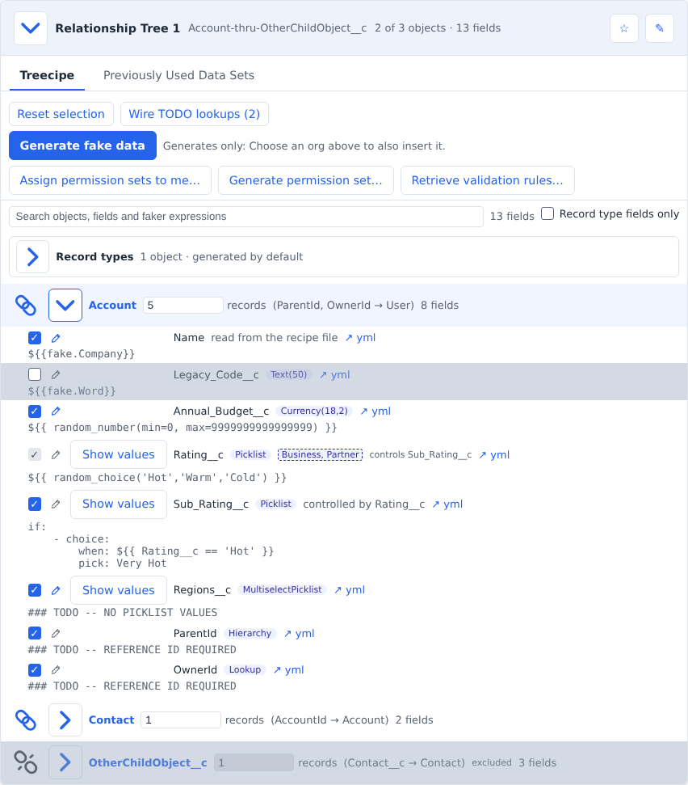
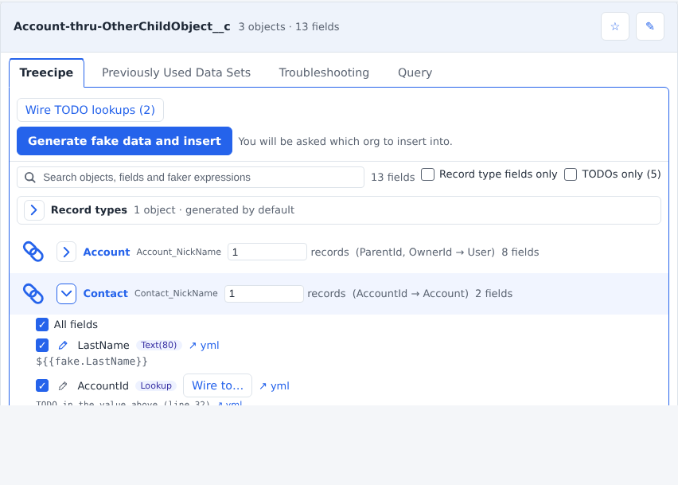
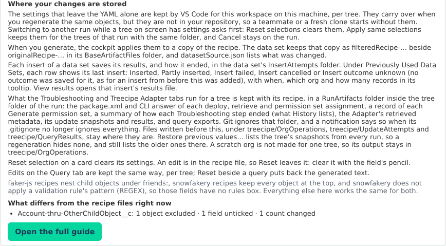

# Recipe Cockpit guide

The Recipe Cockpit shows the recipes Generate Treecipe wrote as cards you can open, trim and generate from.
Click **?** at the top right of the cockpit for the short version of this page. **?** stays pressed while the help is open; close it with **?** again, the **✕** at the help's top right, or Escape. The version and the GitHub icon beside it are one button that opens the CHANGELOG.

A few words used below:

- **Run**: one Generate Treecipe output, a timestamped folder under `treecipe/GeneratedRecipes`.
- **Tree**: a group of related objects written to one recipe file, parents before children. Each card is one tree.
- **Recipe file**: the `.yml` file Run Faker reads to make fake records.

<!-- Kept in step with RECIPE_COCKPIT_HELP_SECTIONS in src/treecipe/src/RecipeCockpitService/RecipeCockpitService.ts by /cockpit-help-sync. The ## headings below must match the help's, in the same order: a test checks them. -->

## Where recipes come from

Generate Treecipe reads your object metadata and writes a run: a folder under `treecipe/GeneratedRecipes` holding the recipe files and a list of the objects it read.
The cockpit opens the newest run, or the one you pick in **Select Generate Treecipe runs by date**, the first line of the **Treecipes** section (or under the toolbar, when a run has no cards to show).
At the top of the panel, the **Target Org Manager** section picks the org a card can insert into, opens it in your browser (**Open in browser**) or makes a new scratch org (**➕ New scratch org**), which it creates and selects without deploying anything to it. Its confirmation offers **Create with Salesforce CLI**, and **Create with @salesforce/core** when this project sets nothing only the CLI would read: that one creates the org inside VS Code without starting the CLI, saves it where the CLI keeps its orgs, and cannot be cancelled once it starts. Beside the chosen org it says what it is: **Scratch org** with the day it expires (read from the Salesforce CLI's local authorization for that org), **Sandbox**, or **Production** with its edition. It says **checking…** until the org has answered. **⟳ Refresh orgs** checks again which authorized orgs are connected, forgets every object description it had read from each org it lists, and checks the chosen org again, so a new login, a permission change or a deploy made elsewhere shows without restarting VS Code. While an insert, a deploy, a permission set assignment, a new scratch org, an open org prompt or a Treecipe Adapter update holds the chosen org, ⟳ leaves the list as it was and says which one it is; press it again once that ends. It stays at the top of the panel while you scroll.
The **Treecipes** section below it starts with the run list, then shows one card at a time: pick it in the **Treecipe** dropdown, which starts on the one you picked last.
Each card is named after the folder its tree was written to: its first object thru its last, such as `Account-thru-Contact`, or `Lead-ONLY` for a single object, until you rename it with the pencil before its name, beside the star that marks it a favorite.
Under the dropdown, a line lists the card's objects in the order they are inserted, and marks each excluded object, whether you excluded it or its parent.
The search box between the run list and the Treecipe dropdown finds a treecipe by its name or folder, or by an object, field or record type in it, and lists what it found. Click a result to open that card on its Treecipe tab at that row.
**Favorites only** narrows the dropdown to your starred cards.
Each card's **Generate fake data and insert** button generates the tree and inserts it into that org; with no org chosen, it asks you for one first, and when something else stops the insert it is disabled and says why. When the reason is one the cockpit can fix, a link beside it opens the place that fixes it: an object the org lacks opens **Troubleshooting › Fields** at **Deploy fields…** (which deploys a custom object with its fields), one the org will not let you create opens **Troubleshooting › Permissions** at **Assign permission sets to me…**, and an unticked field the org requires opens that field's row on the Treecipe tab. It asks nothing about lookups: one still a TODO to an object the tree does not insert is left blank, or, when the org requires it, given a random existing record.
If an insert fails, its message offers **View failed file** (the generated file that failed), **View errors** and **Open Troubleshooting**, which opens the card's Troubleshooting area that may fix it.
To generate without inserting, use **Run Faker by Recipe** from the command palette.

Each object shows its nickname after a 🌳: the name the rows nested under it or pointing to it use for it in the recipe file. The 🌳 marks that name, not a tree card.
Click it to list the fields that point to it, under *Click to go to a child reference*, and jump to one; a field holding a nickname shows it highlighted (**↖ Account_NickName**), and clicking it lists that object under *Click to go to the parent reference*, one click away.
A friend, an object nested under another's `friends:` in a faker-js recipe, shows a 👥 chip for each parent it belongs to: the one it is nested under first, then any other its lookups name.
Each chip reads the parent's nickname and the friend's place among that parent's friends (**Account_NickName-2**); click it to jump to that parent.
A parent with friends shows **👥 N** right after its nickname; click it to list its friends under *Click to go to a friend*, each named as its chip reads (**Account_NickName-2: Case**), and jump to one.

Generate Treecipe marks what still needs a hand edit with a TODO comment, such as a lookup with no parent yet or a validation rule it could not apply.
Tick **Click to show fields with open TODOs**, in the tile under a card's Treecipe search, to see just the fields and objects with one (or the **TODOs only** beside an opened object's **All fields** for that object alone), or open its **Troubleshooting** tab, whose **TODO's** list shows them all: one card per object, which you click to open, then each TODO under its field with a link to its line (**↗ yml**). The same tile holds **Click to show record type impacted fields only**, for the picklist fields a record type restricts, and **Manage record types**, which opens the record types the tree is generated with.
Its **Open** list holds the TODOs still in the recipe, and **Removed** the ones you took out.

The **Troubleshooting** tab shows one area at a time: **TODO's**, **Fields**, **Permissions**, **Validation Rules**, **Record Types**, **Global Value Sets** and **History**, each with its own search.
It opens on the one you chose last.
Each action there is a card you click anywhere on, saying when you would need it and, when it cannot run, why.
**History** lists every Troubleshooting step taken for the tree, from every run of it, in one table: when it ran, the step (a deploy, a retrieve, **Assign permission sets** or **Generate permission set**), the org, how it ended and what it counted, the run, and its files, each a link that opens it.
Click a column's header to sort by it, and again to turn the order; it starts newest first.
A step from before this was recorded shows *Not recorded*, since only its time and files are known.
**Validation Rules** lists each object's validation rules from your project on a card you click to open, its header counting them by what Generate Treecipe did (such as *2 applied · 1 not applied*): whether each is active, its error message, the fields it constrains and whether Generate Treecipe applied it, or why not.
**Show formula** opens a rule's formula.

## What the cockpit changes without editing the YAML

These settings change what is generated, but the recipe file stays exactly as Generate Treecipe wrote it, so it always shows what was generated from your metadata:

- **Excluded objects** (the chain link): the object and its children are left out. A child that another included parent keeps shows a half-broken link and names the excluded parent: it is still generated, without its lookup to that parent.
- **Unticked fields**: the field is left out. **All fields**, above an object's fields, ticks or unticks them all, and **Standard fields** beside it does the same for the fields whose name does not end in `__c`, leaving your custom fields as they are. **Hide unselected** beside them hides that object's unticked fields so you see only what is generated, and is remembered when you come back. Before an insert, the confirmation's **Left out, per object** section lists each excluded object and, under each object, the fields left out: the ones you unticked and any lookup cut because its parent is excluded.
- **Record counts**: each object's row says what is created, such as Create 5 Contact record(s) per Account, the 5 drawn with a pencil (a friend's count is record(s) per parent record). Click the count to change it: Enter keeps it, Escape cancels. A count that differs from the recipe's says changed.
- **The rules box**: a field generated without the limits its validation rules set.
- **Nested copies**: an object written more than once, such as the copy under a self-lookup, a friend added under it or a record type block, is a row of its own, indented under the row it is nested in. Each copy keeps its own unticked fields, count, rules box and edit, so changing one leaves the others as they are. A setting saved before copies had their own still applies to every copy until you change one.

## What does edit the YAML

These buttons rewrite the recipe file itself, because the change belongs in the recipe:

- **Wire to…** and **Wire TODO lookups**: fill a lookup's TODO with its parent's nickname.
- **Create &lt;parent&gt; in recipe**, on a lookup that is still a TODO: adds a standard parent object, such as Account, above the child that needs it. In a faker-js recipe the confirmation also offers **Add as the parent, nest the tree under it**: the child's whole top-level block moves under the new parent's `friends:`, and every TODO lookup in it to that parent is wired. A friend's count is records per parent record. A parent with no template, such as a custom object, draws it disabled and says why.
- **Use existing &lt;parent&gt; from org…**, beside it: pick any connected org, then **Search &lt;parent&gt;** or **Enter a record Id**, which is checked in that org. The Id is written as the lookup's value and the row shows `org record · <org>`; the insert checks the Id exists in the org it inserts into. **Clear**, under the pencil, puts the TODO back.
- **+ Add friend** beside the copy of an object nested under itself: adds one of the object's friends under that copy. The card draws each nested copy, and its friends, indented right under the row it is nested in.
- **Remove TODO** (in the **Troubleshooting** tab's **TODO's** list): takes a TODO comment out of the recipe and lists it under **Removed**, where **Restore** puts it back exactly. The line is kept in a `.removedTodos.json` file beside the recipe. A TODO that is a field's whole value, such as a lookup's, stays.
- **Edit** (the pencil on a field): opens the field's faker expression to change its arguments or call another faker method, or to replace it with one fixed value for every record. On an object written more than once, it changes only the copy whose row you edit. It is written into the recipe so Run Faker by Recipe uses it too. The lines it replaced are kept in a `.fixedValues.json` file beside the recipe, and **Clear** puts them back exactly.
- **Edit values** (under a picklist's faker value): opens a tile for each of its values, ticked for what the field generates now. Untick the values you do not want and **Save**, which is enabled once the ticks change: the field's expression is rewritten to choose only the ticked ones, by the recipe's own backend (faker-js or snowfakery), and saved like an edit. Once the field has an edit, **Reset to generated**, beside **Save**, puts the old lines back. While the tiles are open, **Edit values** is hidden: **Save** or **Cancel** ends the edit. **×** and Escape also close it without saving, and are the way out while the values load. Each record type's own values are listed under the tiles; saving replaces the field's commented record type lines until **Reset to generated** puts them back.

Others write other files: **Remember this selection** saves record types to `treecipe.config.json`, and on a card's **Troubleshooting** tab, **Generate permission set** (under **Permissions**) writes a permission set into your project. **Retrieve validation rules**, **Retrieve fields**, **Retrieve record types** and **Retrieve global value sets**, each under its own area, copy that part of the org chosen in **Target Org Manager** into your project (with none chosen, they ask once and the pick becomes the selection), and change nothing in the org. With the setting **Metadata Retrieve Method** at `jsforce`, these retrieves and the Treecipe Adapter's read straight from the org instead of through the Salesforce CLI (listing an org's validation rules and record types never uses it), and **Cancel** stops a retrieve before anything is written.

The **Troubleshooting** tab also deploys to a sandbox or scratch org, never production: **Deploy permission set** (**Permissions**), **Deploy fields** (**Fields**: custom fields and the custom objects that hold them, with an optional box for every tree object's validation rules, record types and global value sets), **Deploy record types** (**Record Types**) and **Deploy global value sets** (**Global Value Sets**) each send just those parts of your project, after a confirmation that lists them and says how it deploys: through the Salesforce CLI, or, with the setting **Metadata Deploy Method** at `jsforce`, straight to the org, where **Cancel** cancels the deploy in the org. Every confirmation that acts on an org shows its alias in bold and its username beside it; **Change org…** there picks another org, makes it the one chosen in **Target Org Manager**, and starts the action again.

Each of these asks first, in a box over the cockpit. Scroll it to read everything it will do; **Cancel** or Escape does nothing.

The **Query** tab writes no recipe either. It lists the SOQL Generate Treecipe wrote for the tree (the same queries as the tree folder's `soql-sosl-templates--….md`). Edit a query, **Run** it against the org chosen in Target Org Manager (the button reads **Run in** and the org's name; with none chosen, **Run…** asks once over the same list and the pick becomes the selection). A query only reads, so the CLI's default org can be queried even when it is production; no other production org can be, since the picker never lists one, and **Export JSON** or **Export CSV** what came back, under `GeneratedRecipes/<run>/<tree folder>/RunArtifacts/QueryResults/`, which git ignores. A run reads at most 50,000 records or 1,000,000 values, and the tab previews the first 50 rows and 50 columns.

The **Treecipe Adapter** tab, after **Query**, walks you through two steps. **Step 1:** choose the **Parent object** (the dropdown starts on the tree's root) and, if you want, type a **WHERE** for the parent records you expect, such as `Name LIKE 'Acme%'`, then **Next**. **Step 2:** the tab draws that object and every object whose lookups lead up to it, as the Treecipe tab does, each object once, under a **Filter by fields & objects to add** box. **Change parent** goes back to step 1 and keeps what you typed. Beside the filter, **Retrieve latest metadata** retrieves the objects step 2 draws from the sandbox or scratch org chosen in **Target Org Manager** (with none chosen it asks, as **Load records** does) into a folder under the tree's `RunArtifacts/OrgOperations/<username>/`, never into your package directories, and compares each field with your project's file. A custom field your project has no file for is marked **new in org** and drawn as a row of its own; a field whose type, length, precision, scale, required, lookup, value set or picklist values differ is marked **changed in org**, with what changed in its tooltip; each object counts its changes, and the filter finds them. A custom child object the org has and the tree does not is drawn under its parent as **new child object in org**. Under **Recent changes in the org** the tab lists what the org's source tracking and the last 180 days of its setup audit trail say about these objects, or why it could not read them; these are hints, and the marks always come from the files. Nothing in your project changes until you press **Apply retrieved files to project**: it lists every file it would overwrite or add and asks first, copies a changed field over your project's file and a new one into your default package directory, and offers **Generate Treecipe** so the recipe picks them up. Nothing is deployed. You can press it at any time no load or update is running. A field marked **new in org** that the recipe does not list can be ticked like any other and filled on the loaded records without regenerating the treecipe: its row shows the faker expression the recipe's own backend (faker-js or snowfakery) writes for its type in the org, which the pencil can edit, or, for a type the backend writes no expression for, says it takes a **fixed value only**. A lookup, a formula, a roll-up summary or auto number field and a dependent picklist only the org holds stay locked, each saying why. The snapshot and results of an update say which fields were only in the org, and **Restore previous values…** puts them back too. Tick the fields you want to fill on records an org already holds, and its search narrows the rows by field name, label, type or faker expression. A lookup, `RecordTypeId`, a dependent picklist, an auto number or roll-up summary field (Salesforce sets those) and a field read only from the recipe file cannot be chosen, and each says why. The cockpit remembers the fields you ticked.

**Load records** reads the tree's existing records from the sandbox or scratch org chosen in **Target Org Manager**; with none chosen it asks for one in the command palette, as the insert does. It reads every object step 2 draws: the record Id, the lookups to the tree's other objects and the fields you ticked. The parent's records are the ones step 1's WHERE asks for. Then it reads a level at a time, and each object below the parent reads only the records whose lookup points to a record the level above loaded: Contacts under the loaded Accounts, then Opportunities under those Contacts. An object with lookups to several loaded objects reads under the deepest of them, so an Opportunity with both an Account and a Contact lookup reads under the Contacts. Under each object below the parent you can also type a **WHERE** (such as `CreatedDate = LAST_N_DAYS:30`) to narrow it further. When the level above loaded no records, or could not be read, nothing under it is read, and it says so; a load that read no records at all leaves **Generate values** and **Update records** disabled. Each object then shows how many records it has and its first 10 rows, or why the org would not read it. A load reads at most 50,000 records and 1,000,000 values in all; an object after that limit is not read and says so. A WHERE ending in `FOR UPDATE`, `FOR VIEW` or `FOR REFERENCE` is refused, since those change or lock records. It only reads.

**Generate values** makes a new value for every loaded record of each ticked field. By default a field's value comes from the faker expression its recipe holds (or the edit you made to it on the Treecipe tab), generated by the recipe's own backend (faker-js or snowfakery) from a temporary recipe outside your workspace. The pencil beside a field changes that: start with `${{` to edit the expression, or type anything else to give every record that fixed value. The checks are the Treecipe tab's (a number, a date, a declared picklist value, no template in a fixed value). Your edit stays in the Adapter; it is never written to the recipe. Values are made 2,000 records at a time, and the progress notification can cancel the run. Before anything runs, a confirmation lists every field with where its value comes from, an edited expression in full. Each object then shows its first 10 rows as Id, current value and new value. A field ticked after the last load needs **Load records** again, so its current value is read.

**Update N records in …** writes those values to the loaded records by Id. It writes only to the sandbox or scratch org the records were loaded from, and only once the cockpit has checked that the org lets you update every field. A confirmation lists each object's record count and fields, then you choose all-or-none as for an insert. Before anything is sent, the records' current values are saved to the tree's `RunArtifacts/UpdateAttempts/<timestamp>-before.json` (a folder git ignores), and nothing is sent if that save fails. Records go 200 per request, parents first, and the results are written beside the snapshot. Without all-or-none every request is sent and a record the org rejects is listed in the results. With it, the first request that fails stops the update, and the records already updated are set back to their old values. A picklist value is the field's own list, not its record type's, so a record whose record type does not allow the value is rejected by the org and listed there. Once anything was sent, the loaded records and values are spent: load again to see the new values.

An update that lands leaves a copy you can reopen and reproduce. The data set `treecipe/FakeDataSets/<tree folder>-adapted-<yyyyMMdd-HHmmss>` (`-2` for a second one in the same second) holds every record the load read, each one the org saved carrying its new value, as Collections API files keyed by Id, so **Insert Data Set by Directory** still works on it. Its `datasetSource.json` records the parent object, its WHERE, the org, and the fields updated, marking those only the org held. It appears under **Previously Used Data Sets** labelled **adapted**. Beside your recipe, which is never changed, `<recipe>-adapted-<yyyyMMdd-HHmmss>.yml` is the same recipe with every adapted field line ending in `# ADAPTED <yyyy-MM-dd> -- <org alias>`: a field whose value came from the recipe keeps its lines, and any other is written as the value it was generated from; a field only the org held is added. It is a side file: the card's generate button still uses the original, and **Run Faker by Recipe** can run it. The update's notification offers **Open data set** and **Open adapted recipe**. Nothing is written when all-or-none set every update back.

**Previous updates** lists the snapshots this tree's updates saved, newest first, by file name. **Restore previous values…** writes one back: every record it names is set back by Id to the value it held when the snapshot was saved. It restores only in the sandbox or scratch org the snapshot was taken in, selected in Target Org Manager. The snapshot is a file in your workspace, so it is checked before anything is sent: a file that is not JSON, names another tree or org, or holds an object, field, Id or value the cockpit did not write (a lookup, a record type, a field of another object, a malformed Id) is refused whole. The guards are the update's: the org is checked as a sandbox before and after the confirmation, every field must be updateable there, and you choose all-or-none. The values the records hold now are read and saved first as a new snapshot, which is listed too, so a restore can itself be restored; a record the org no longer returns is left out and counted. The results go beside that snapshot.

## Where your changes are stored

The settings that leave the YAML alone are kept by VS Code for this workspace on this machine, per tree.
They carry over when you regenerate the same objects, but they are not in your repository, so a teammate or a fresh clone starts without them.
Switching to another run while a tree on screen has settings asks first: Reset selections clears them, Apply same selections keeps them for the trees of that run with the same folder, and Cancel stays on the run.

When you generate, the cockpit applies them to a copy of the recipe.
The data set keeps that copy as `filteredRecipe-…` beside `originalRecipe-…` in its `BaseArtifactFiles` folder, and `datasetSource.json` lists what was changed.
Each insert of a data set saves its results, and how it ended, in the data set's `InsertAttempts` folder.
Under **Previously Used Data Sets**, each row shows its last insert: ✅ **Inserted**, ⚠️ **Partly inserted**, ❌ **Insert failed**, 🚫 **Insert cancelled** or ❔ **Insert outcome unknown** (no outcome was saved for it, as for an insert from before this was added), with when, which org and how many records in its tooltip.
**View results** opens that insert's results file.
A row's **Insert…** inserts into the sandbox or scratch org chosen in **Target Org Manager** (with none chosen, it asks), after a confirmation that lists its records per object and offers **Change org…**.
What the **Troubleshooting** and **Treecipe Adapter** tabs run for a tree is kept with its recipe, in `GeneratedRecipes/<run>/<tree folder>/RunArtifacts/`: the package.xml and CLI answer of each deploy and retrieve, and the org's answer to each permission set assignment (`OrgOperations/<username>/`), a record of each **Generate permission set…** (`PermissionSets/`), a `<time>-<step>-summary.json` beside each Troubleshooting step's files saying how it ended (what **History** lists), the Adapter's retrieved metadata (`OrgOperations/<username>/`), its update snapshots and results (`UpdateAttempts/`), and query exports (`QueryResults/`).
Git ignores that folder through its own `.gitignore`, and a notification says so when that file no longer ignores everything.
Files written before this, under `treecipe/OrgOperations`, `treecipe/UpdateAttempts` and `treecipe/QueryResults`, stay where they are. **Restore previous values…** lists the tree's snapshots from every run, so a regeneration hides none, and still lists the older ones there.
A scratch org is not made for one tree, so its output stays in `treecipe/OrgOperations`.
**Reset Selections**, right of a card's **Generate fake data and insert** button, clears its settings. An edit is in the recipe file, so Reset leaves it: clear it with the field's pencil.
Edits on the **Query** tab are kept the same way, per tree; **Reset** beside a query puts back the generated text.

## faker-js and snowfakery

faker-js recipes nest child objects under `friends:`, snowfakery recipes keep every object at the top.
snowfakery does not apply a validation rule's pattern (`REGEX`), so those fields have no rules box.
Everything else on this page works the same for both.
