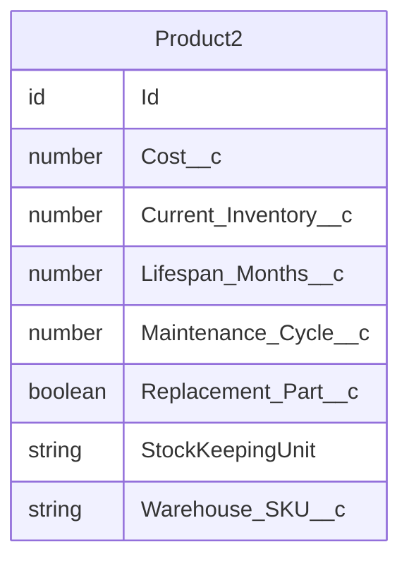

# Entity Relationship Diagram

This diagram illustrates the object model for the Salesforce entities in this Treecipe tree.
Each entity block lists its typed fields (string, number, date, datetime, boolean).
Lookup relationships are shown with `|o--o{` cardinality (optional parent).
MasterDetail relationships are shown with `||--o{` cardinality (required parent).
Cross-tree relationships are excluded — only objects present in this recipe are shown.

Generated: {TIMESTAMP}
Objects: Product2

---

